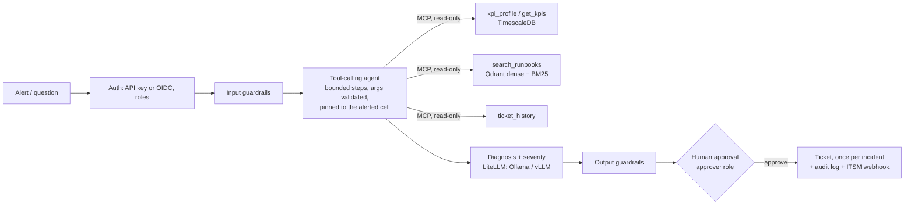

# Telecom Operations AI Assistant

[](https://github.com/mohamed-amin-ai/telecom-ops-assistant/actions/workflows/ci.yml)


An agentic RAG assistant for telecom network operations. An alert comes in; an LLM agent chooses among
read-only tools (KPI anomaly profile, runbook search, ticket history), grounded in 3GPP specifications and
runbooks; an engineer reviews the diagnosis; only an explicit human approval creates the ticket.
Everything runs on free, self-hosted models (Ollama or vLLM). No paid API is used anywhere.



The model cannot write: `create_ticket` is not in its tool list or on the MCP server. The incident flow is a
LangGraph graph checkpointed to Postgres, so a pending approval survives a restart.

## Results

All figures are from CI or from a Kaggle 2x Tesla T4 run (vLLM, tensor parallel 2, Qwen2.5-7B-Instruct). Method,
intervals and caveats: [docs/evaluation.md](docs/evaluation.md).

| What | Result |
|---|---|
| Retrieval, 148 questions (hybrid + rerank) | hit@k 0.973, MRR 0.953; 110 standard questions 0.991 / 0.982, 38 hard ones 0.921 / 0.868 |
| Fault detection, ground-truth (3 injected faults x 3 runs, 6 healthy pairs x 3) | 9/9 found, 0/18 false alarms |
| Tools chosen by the 7B model unaided (30 + 27 incidents) | 100%; safety-net fallback 0% |
| Tool selection, 1.5B / 3B models | 86% / 93% on a **held-out** set of 42 unseen scenarios (93% / 95% on the tuning set) |
| Writes attempted by the 1.5B and 3B models | 0 in 85 scenarios (no write tool is exposed to any model) |
| Time per incident, request to "awaiting approval" | median 25 s, p95 29 s (30 runs, 30/30 succeeded, min 21 s, max 30 s) on 2x T4; two other sessions gave medians of 30 s and 37 s |
| Prompt-injection red team, 14 unseen attacks / 20 benign questions | 71% (10/14) blocked with the LLM classifier, 1/20 benign wrongly blocked; rules alone 29% (4/14). Small sample |
| Tests | 217 tests; 11-job CI incl. real Postgres/Redis/Qdrant stack, UI end-to-end, soak test, backup/restore, rollback |

## Quick start

```bash
cp .env.example .env     # fill in the required secrets (compose refuses to start without them)
docker compose -f docker-compose.yml -f docker-compose.dev.yml up -d --build
docker compose exec api python -m scripts.ingest      # index data/docs
docker compose exec api python -m scripts.seed_kpis   # synthetic KPIs with 3 injected faults
```

- Chat UI <http://localhost:8080>. Try `/incident CELL_001 prb_utilization_pct PRB above 85%`.
- API docs <http://localhost:8000/docs>; metrics `/metrics`; Langfuse <http://localhost:3000>.
- Create users: `docker compose exec api python -m scripts.create_api_key --name alice --role approver`.
- Local model: add `--profile local`, then `docker compose exec ollama ollama pull qwen2.5:7b-instruct`.
- `make help` lists shortcuts (`make up`, `make ingest`, `make seed`, `make test`).
- Tests: `pip install -r requirements.txt -r requirements-eval.txt pytest pytest-asyncio ruff && pytest -q`
  (no services needed). GPU benchmark: [kaggle/README.md](kaggle/README.md).

Production overlay (TLS, workers, Prometheus, Grafana), backups, secrets, SSO, ITSM and tracing:
[docs/operations.md](docs/operations.md). On-call runbook and SLO targets: [docs/oncall.md](docs/oncall.md).

## Stack

LangGraph, LiteLLM (Ollama, vLLM), MCP (FastMCP server, persistent client session), Qdrant (dense + BM25, RRF,
optional rerank), FastEmbed, TimescaleDB/Postgres, Redis, FastAPI, Chainlit, Langfuse, OpenTelemetry, Prometheus,
Grafana, Caddy, Docker Compose, GitHub Actions, RAGAS, vLLM tensor parallelism.

## Repository

| Path | Purpose |
|---|---|
| `app/agent.py`, `app/investigator.py` | LangGraph flow with approval gate; bounded tool-calling agent with safety net |
| `app/mcp_server.py`, `app/mcp_client.py` | Read-only tools over MCP |
| `app/rag.py`, `app/stats.py`, `app/tools.py` | Hybrid retrieval; per-time-slot anomaly detector; KPI, tickets, ITSM webhook |
| `app/auth.py`, `app/audit.py`, `app/guardrails.py` | API keys and OIDC, roles, append-only audit; input/output guardrails |
| `app/llm.py`, `app/metrics.py`, `app/tracing.py` | LiteLLM routing; Prometheus; OpenTelemetry |
| `evals/` | Retrieval, red team, RAGAS, tool-selection (tuned + held-out), end-to-end agent eval |
| `db/migrations/`, `ops/`, `scripts/`, `kaggle/` | Schema, Caddy/Prometheus/Grafana, tooling, GPU benchmark |
| `docs/` | Evaluation, operations, on-call, engineering log |

## Limitations

- **Synthetic data.** KPI series are generated with injected faults, so detection scores show the pipeline works,
  not how it performs on real traffic. `scripts/import_kpis.py` loads real exports; real runbooks are still needed.
- **Small, same-author evals.** 9 cell/KPI pairs, scenario sets written by the author, and an LLM judge that is the same
  7B model as the generator (indicative only). Intervals are wide and shown.
- **One GPU setup measured** (2x T4). Latency varies 25-37 s between sessions; no other hardware was tested.
- **Integrations are tested against stubs:** the OIDC path with locally generated keys, the Jira adapter against a
  stubbed HTTP layer; neither against a real identity provider or Jira.

MIT license.
