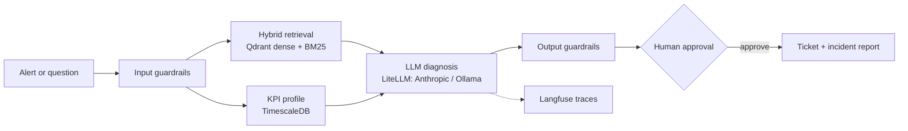

# Telecom Ops Assistant

[](https://github.com/mohamed-amin-ai/telecom-ops-assistant/actions/workflows/ci.yml)


RAG + agentic assistant for telecom network operations. Alert in, then KPI profile and
runbook retrieval, diagnosis, human approval, ticket, incident report. No AWS dependency.



## Run
```bash
cp .env.example .env                 # set ANTHROPIC_API_KEY
docker compose up -d --build         # add --profile local for Ollama fallback
docker compose exec api python -m scripts.ingest      # index data/docs
docker compose exec api python -m scripts.seed_kpis   # synthetic KPIs with 3 injected faults
```
- Chat UI: http://localhost:8080. Ask a question, or run
  `/incident CELL_001 prb_utilization_pct PRB above 85%` (also try `CELL_002
  rrc_setup_success_rate`, `CELL_003 handover_success_rate`). Approve to create the ticket.
- API docs: http://localhost:8000/docs
- Langfuse: http://localhost:3000. Create a project, paste the keys into `.env`, then
  `docker compose up -d api`.
- Local model: `docker compose exec ollama ollama pull qwen2.5:7b-instruct`.

## CI
- `test`: ruff and pytest.
- `stack`: builds and starts the whole compose stack (Qdrant, TimescaleDB, Langfuse, API, UI),
  ingests the docs with real embeddings, checks retrieval floors, runs the rule-based
  guardrail eval, lists the MCP tools, then runs `scripts/e2e_smoke.py` (incident flow with
  approval, guardrail blocks, anomaly flags, UI and Langfuse health). The LLM is mocked
  (`LLM_MOCK=1`), so no secrets are needed.
- `live`: runs only when the `ANTHROPIC_API_KEY` repository secret is set. Guardrail eval with
  the LLM classifier, the same smoke test against the real model, and the generation eval on a
  30-question sample. The floors (pass 0.7, faithfulness 0.8, guardrail accuracy 0.9) are
  untuned guesses: adjust them after your first run.

## Evals
```bash
docker compose exec api python -m evals.run_eval          # retrieval: dense vs hybrid vs hybrid+rerank
docker compose exec api python -m evals.run_gen_eval --limit 30   # answers: correctness, faithfulness, abstention
docker compose exec api python -m evals.run_guard_eval    # guardrails: injection, privacy, scope, PII
```
`evals/golden_set.jsonl` has 121 questions (110 answerable, 11 unanswerable) written against
the 22 documents in `data/docs/`. `evals/guardrail_set.jsonl` has 38 input cases. Change `RETRIEVAL_MODE` / `RERANK` in `.env`, restart the
api, and re-run `run_gen_eval` to compare configurations. Failures are written to
`evals/last_failures.json`.

### Measured in CI (real embeddings: bge-small + BM25 + MiniLM reranker, k=3, 110 answerable questions)
| mode | hit@3 | MRR |
|---|---|---|
| dense | 0.982 | 0.959 |
| hybrid | 0.991 | 0.973 |
| hybrid + rerank | 0.991 | 0.986 |

Numbers move by a few thousandths between runs. The corpus and questions are both synthetic, so retrieval is close to saturated and the
differences are small. Real runbooks and harder questions will separate the modes more.

## Guardrails
- **Input** (`/ask`): PII redaction (emails, phone numbers, IMSI/IMEI/MSISDN-length IDs),
  deterministic rules for prompt injection and subscriber tracking, then a small LLM
  classifier (`GUARD_MODEL`) that blocks off-topic, injection and harmful requests.
- **Alerts** (`/incident`): the free-text description gets redaction and the rules (no
  LLM call). Cell ID and KPI name are pattern-validated.
- **Output**: PII redaction, and answers with neither a `[source#chunk]` citation nor an
  abstention get an "unverified" note. Retrieved text and alert text are treated as data
  in the prompts.
- **Actions**: tools are read-only; tickets are created only after human approval.
- **API**: optional `X-API-Key` (set `API_KEY`), per-client rate limit, request size limits.
- Switches: `GUARDRAILS=0` disables all; `GUARD_LLM=0` keeps the rules and drops the
  classifier. If the classifier call fails it fails open (rules still apply) and logs.

## Layout
- `app/rag.py`: ingest and hybrid retrieval (Qdrant dense + BM25, RRF, optional rerank)
- `app/agent.py`: LangGraph flow with human approval (`interrupt`)
- `app/tools.py`, `app/stats.py`: KPI query and local same-hour-baseline z-score profile
- `app/mcp_server.py`: read-only tools over MCP (`python -m app.mcp_server`)
- `app/guard_rules.py`, `app/guardrails.py`: input/output guardrails
- `app/llm.py`: LiteLLM entry point (Anthropic primary, Ollama fallback, Langfuse tracing)
- `ui/app.py`: Chainlit UI
- `evals/`: golden set, retrieval ablation, LLM-judge generation eval

## Limits
- The 22 documents are synthetic: operational thresholds and policies are invented, and
  the two concept primers (16, 17) are written from general knowledge, so check them against
  the 3GPP specs before relying on them. Replace them with your own runbooks when you have
  them.
  Scores show the pipeline works and let you compare configurations, but the questions
  overlap the docs closely, so expect high numbers. Add your own documents and harder,
  paraphrased questions before drawing conclusions.
- Guardrails are heuristic. Regex rules miss paraphrased attacks and the LLM classifier can
  err in both directions; grow `guardrail_set.jsonl` with real traffic.
- The agent calls tools directly. The MCP server is for external clients.
- Tickets go to `data/tickets.jsonl`, and agent state is in memory (lost on restart).
