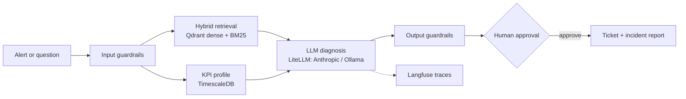

# Telecom Ops Assistant

[](https://github.com/mohamed-amin-ai/telecom-ops-assistant/actions/workflows/ci.yml)


RAG + agentic assistant for telecom network operations. Alert in, then KPI profile and
runbook retrieval, diagnosis, human approval, ticket, incident report. No cloud dependency.



## Run
```bash
cp .env.example .env                 # set ANTHROPIC_API_KEY (or OPENROUTER_API_KEY, see below)
docker compose up -d --build         # add --profile local for Ollama fallback
docker compose exec api python -m scripts.ingest      # index data/docs
docker compose exec api python -m scripts.seed_kpis   # synthetic KPIs with 3 injected faults
```
Migrations (`db/migrations/*.sql` plus LangGraph's own checkpoint tables) run automatically
via a one-shot `migrate` service before `api` starts; re-run by hand any time with
`docker compose run --rm migrate`.
- Chat UI: http://localhost:8080. Ask a question, or run
  `/incident CELL_001 prb_utilization_pct PRB above 85%` (also try `CELL_002
  rrc_setup_success_rate`, `CELL_003 handover_success_rate`). Approve to create the ticket.
- API docs: http://localhost:8000/docs
- Langfuse: http://localhost:3000. Create a project, paste the keys into `.env`, then
  `docker compose up -d api`.
- Local model: `docker compose exec ollama ollama pull qwen2.5:7b-instruct`.
- OpenRouter instead of a direct Anthropic key: set `OPENROUTER_API_KEY` and point
  `LLM_MODEL` / `JUDGE_MODEL` / `GUARD_MODEL` at `openrouter/<provider>/<model>` strings
  (e.g. `openrouter/anthropic/claude-3.5-sonnet`) -- see the comments in `.env.example`.

## CI
- `test`: ruff and pytest (no database, Redis, or LLM needed).
- `stack`: builds and starts the whole compose stack (Qdrant, TimescaleDB, Redis, Langfuse,
  API, UI), runs migrations, ingests the docs with real embeddings, checks retrieval floors,
  and runs the real LiteLLM code path (guardrail classifier, agent, judge) against a fake
  Anthropic server (`scripts/fake_anthropic.py`, `docker-compose.ci.yml`) so no API key is
  needed but every line between our code and the Anthropic wire format still runs. It then
  runs `scripts/e2e_smoke.py` (incident flow with approval, guardrail blocks, anomaly flags
  on 3 seeded cells, a real Postgres-backed ticket and checkpoint), `scripts/e2e_ui.py`
  (headless-browser Chainlit flow: ask, incident, approve, ticket), `scripts/load_test.py`
  (20x concurrency smoke, latency percentiles), and `scripts/check_langfuse.py` (confirms
  traces actually arrived). Set `LLM_MOCK=1` locally for a fast loop that skips the LLM
  entirely; CI does not use it.
- `live-ollama`: runs on every push, no API key or account needed at all -- pulls a small
  model (`qwen2.5:1.5b-instruct`) into the local Ollama service and runs
  `scripts/e2e_smoke.py` against it. GitHub Actions minutes are unlimited for public repos,
  so this costs nothing. A model this small is far weaker than Claude, so it only proves the
  real LiteLLM/RAG/agent code path works end to end with a genuine model, not that answers
  are good; guardrails run on rules only here (`GUARD_LLM=0`) since a model this size isn't
  reliable at the classifier's strict JSON output.
- `live`: runs when either the `ANTHROPIC_API_KEY` or `OPENROUTER_API_KEY` repository secret
  is set (Anthropic preferred if both are). Guardrail eval with the real LLM classifier, the
  same smoke and UI tests against the real model, the generation eval on a 30-question
  sample, and a concurrency smoke test. The floors (pass 0.7, faithfulness 0.8, guardrail
  accuracy 0.9) are untuned guesses: adjust them after your first run. OpenRouter enforces
  its own per-account limits independent of anything in this repo: new/unfunded accounts get
  a 20 requests/minute cap per model and a small concurrent ("in-flight") request budget --
  with zero credits, expect this job to fail intermittently under its call volume regardless
  of retries. `live-ollama` above is the free alternative for a genuine (if much weaker)
  end-to-end model check.

## Evals
```bash
docker compose exec api python -m evals.run_eval          # retrieval: dense vs hybrid vs hybrid+rerank
docker compose exec api python -m evals.run_gen_eval --limit 30   # answers: correctness, faithfulness, abstention
docker compose exec api python -m evals.run_guard_eval    # guardrails: injection, privacy, scope, PII
python scripts/load_test.py --url http://localhost:8000   # concurrency: latency percentiles, error rate
```
`evals/golden_set.jsonl` has 121 questions (110 answerable, 11 unanswerable) written against
the 22 documents in `data/docs/`. `evals/guardrail_set.jsonl` has 38 input cases. Change `RETRIEVAL_MODE` / `RERANK` in `.env`, restart the
api, and re-run `run_gen_eval` to compare configurations. Failures are written to
`evals/last_failures.json`.

### Measured in CI (real embeddings: bge-small + BM25 + MiniLM reranker, k=3, 110 answerable questions)
| mode | hit@3 | MRR |
|---|---|---|
| dense | 0.982 | 0.959 |
| hybrid | 0.991 | 0.973 |
| hybrid + rerank | 0.991 | 0.986 |

Numbers move by a few thousandths between runs. The corpus and questions are both synthetic, so retrieval is close to saturated and the
differences are small. Real runbooks and harder questions will separate the modes more.

### Concurrency (measured locally, fake LLM, single uvicorn worker)
| concurrency | total requests | errors | p50 | p95 | p99 |
|---|---|---|---|---|---|
| 10 | 30 | 0 | 89ms | 105ms | 106ms |
| 50 | 200 | 0 | 456ms | 718ms | 929ms |

No errors at either level, but latency scales roughly with concurrency -- this is one
process with FastAPI's default sync threadpool, not multiple workers. See "Not production
grade yet" below.

## Guardrails
- **Input** (`/ask`): PII redaction (emails, phone numbers, IMSI/IMEI/MSISDN-length IDs),
  deterministic rules for prompt injection and subscriber tracking, then a small LLM
  classifier (`GUARD_MODEL`) that blocks off-topic, injection and harmful requests.
- **Alerts** (`/incident`): the free-text description gets redaction and the rules (no
  LLM call). Cell ID and KPI name are pattern-validated.
- **Output**: PII redaction, and answers with neither a `[source#chunk]` citation nor an
  abstention get an "unverified" note. Retrieved text and alert text are treated as data
  in the prompts.
- **Actions**: tools are read-only; tickets are created only after human approval.
- **API**: optional `X-API-Key` (set `API_KEY`), request size limits, and a sliding-window
  rate limit shared across replicas via Redis (`app/ratelimit.py`) -- falls back to a
  per-replica in-process count if Redis is unreachable, so a Redis outage degrades rate
  limiting instead of taking the API down.
- Switches: `GUARDRAILS=0` disables all; `GUARD_LLM=0` keeps the rules and drops the
  classifier. If the classifier call fails it fails open (rules still apply) and logs.

## Layout
- `app/rag.py`: ingest and hybrid retrieval (Qdrant dense + BM25, RRF, optional rerank)
- `app/agent.py`: LangGraph flow with human approval (`interrupt`), checkpointed to
  Postgres -- an incident survives a process restart, verified by resuming one in a
  brand-new process with a brand-new connection pool
- `app/db.py`: shared Postgres connection pool
- `app/tools.py`, `app/stats.py`: KPI query, local same-hour-baseline z-score profile,
  and tickets persisted to a real `tickets` table (not a file)
- `app/ratelimit.py`: Redis-backed rate limiter with in-process fallback
- `app/mcp_server.py`: read-only tools over MCP (`python -m app.mcp_server`)
- `app/guard_rules.py`, `app/guardrails.py`: input/output guardrails
- `app/llm.py`: LiteLLM entry point (Anthropic or OpenRouter primary, Ollama fallback,
  Langfuse tracing)
- `ui/app.py`: Chainlit UI
- `db/migrations/`, `scripts/migrate.py`: versioned schema migrations, tracked in a
  `schema_migrations` table, applied by a one-shot compose service
- `evals/`: golden set, retrieval ablation, LLM-judge generation eval, guardrail eval
- `scripts/load_test.py`: concurrency smoke test (latency percentiles, error rate)

## Found and fixed by actually running it end to end
`docker compose up` had never been run before the `stack` CI job below existed, because it
was built and validated with stubbed embeddings and a mocked LLM. Running the real stack
found real bugs, each with a regression test so it can't silently come back:
- **LiteLLM rejects `temperature=0` for `claude-sonnet-5`** (only `temperature=1` is
  accepted, and the error surfaces on every single call). `app/llm.py` now retries once
  without `temperature` when this specific error is raised. Without this fix, every real
  Anthropic call in this app would have failed immediately. (`tests/test_llm.py`)
- **The KPI anomaly check missed faults on ratio KPIs near 100%.** An 8-point RRC success
  rate drop scored a z-score of only about -1.8 against the 3.0 threshold, because the
  noise floor in `app/stats.py` was 5% of the baseline level, which is huge for a KPI that
  normally varies by tenths of a point. Tightened to 1%. (`tests/test_stats.py`)
- **Headless Chromium's POSIX locale broke Chainlit's own settings endpoint**, leaving the
  chat composer blank. Fixed by forcing the browser context's locale.
- **The chat composer silently cleared text typed during Chainlit's socket handshake.**
  Fixed with a type-verify-retry helper instead of trusting a fixed delay.
- **No `.dockerignore` meant the CI-generated `.env` file was baked into every image via
  `COPY . .`**, and Chainlit's own `__init__.py` unconditionally reloads `.env` from its
  working directory on import -- so the UI container picked up the API's `DATABASE_URL`
  regardless of what docker-compose set for that service, and Chainlit tried to use it as
  its own (incompatible) chat-persistence database, breaking `/project/settings`. This also
  meant `ANTHROPIC_API_KEY` and everything else in `.env` was leaking into every image
  layer. A `.dockerignore` fixes both.

Every one of these passed the earlier `LLM_MOCK=1` / no-`.dockerignore` setup silently.

## Not production grade yet
This has real Postgres-backed agent state, a real ticket table, versioned migrations, a
shared rate limiter, and a CI pipeline that actually runs the stack -- but calling it
production grade would overstate it. Still missing, roughly in order of what would bite
first:
- **Horizontal scaling**: one uvicorn worker, no load balancer, no autoscaling. The
  connection pool (`app/db.py`) is sized for one process (`max_size=10`); running multiple
  replicas needs that revisited.
- **Real load testing**: `scripts/load_test.py` is a smoke test (does it fall over at all),
  not a load test against production-shaped traffic and infrastructure -- no k6/Locust run,
  no soak test, no numbers under sustained load or with real embeddings/LLM latency.
- **Deployment**: no Kubernetes/Helm, no TLS termination or reverse proxy, no rolling
  deploy or rollback story, no CORS configuration.
- **Secrets**: a `.env` file. No secrets manager, no rotation.
- **Auth**: a single shared `X-API-Key`. No per-user auth, no RBAC, no multi-tenancy.
- **Backup/restore**: none configured for Postgres or Qdrant.
- **Observability**: Langfuse traces exist, but there's no alerting, no SLOs, no error
  tracking (Sentry or similar), no on-call story.
- **Guardrail adversarial testing**: `guardrail_set.jsonl` is 38 cases I wrote myself. No
  real red-teaming has happened.
- **MCP wiring**: the server exists (`app/mcp_server.py`) but the agent calls tool functions
  directly, not through it -- it's unused surface area for now.
