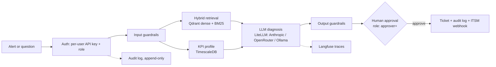

# Telecom Ops Assistant

[](https://github.com/mohamed-amin-ai/telecom-ops-assistant/actions/workflows/ci.yml)


RAG + agentic assistant for telecom network operations. Alert in, then KPI profile and
runbook retrieval, diagnosis, human approval, ticket, incident report. No cloud dependency.



## Run
```bash
cp .env.example .env
# Fill in: an LLM key (ANTHROPIC_API_KEY or OPENROUTER_API_KEY), BOOTSTRAP_API_KEYS,
# CHAINLIT_AUTH_SECRET, LANGFUSE_NEXTAUTH_SECRET, LANGFUSE_SALT (docker-compose.yml refuses
# to start any of these missing -- that's deliberate, not a bug).
docker compose -f docker-compose.yml -f docker-compose.dev.yml up -d --build
docker compose exec api python -m scripts.ingest      # index data/docs
docker compose exec api python -m scripts.seed_kpis   # synthetic KPIs with 3 injected faults
```
Migrations (`db/migrations/*.sql`, LangGraph's checkpoint tables, `BOOTSTRAP_API_KEYS`) run
automatically via a one-shot `migrate` service before `api` starts; re-run any time with
`docker compose run --rm migrate`.

- **Chat UI:** http://localhost:8080. Sign in with a bootstrapped user's name and key. Ask a
  question, or run `/incident CELL_001 prb_utilization_pct PRB above 85%` (also try
  `CELL_002 rrc_setup_success_rate`, `CELL_003 handover_success_rate`). Approving needs the
  `approver` role or higher.
- **API docs:** http://localhost:8000/docs. Every route but `/health` needs `X-API-Key`.
- **Metrics:** http://localhost:8000/metrics (Prometheus format).
- **Langfuse:** http://localhost:3000.
- **Manage API keys:** `docker compose exec api python -m scripts.create_api_key --name alice --role approver` (prints the key once; only its hash is stored). `--revoke NAME`, `--list`.
- **OpenRouter instead of a direct Anthropic key:** set `OPENROUTER_API_KEY` and point
  `LLM_MODEL` / `JUDGE_MODEL` / `GUARD_MODEL` at `openrouter/<provider>/<model>` strings --
  see `.env.example`.
- **Local model, no key at all:** `docker compose -f docker-compose.yml -f docker-compose.dev.yml --profile local up -d`, then `docker compose exec ollama ollama pull qwen2.5:7b-instruct`.

### Production
```bash
# every ${VAR:?...} in docker-compose.yml and docker-compose.prod.yml must be set in .env
DOMAIN=ops.example.com ACME_EMAIL=you@example.com docker compose \
  -f docker-compose.yml -f docker-compose.prod.yml up -d --build
```
Adds Caddy (automatic TLS, HSTS, security headers; the only service reachable from outside
the Docker network -- `/metrics` is explicitly blocked on its public listener), multiple
uvicorn workers (`API_WORKERS`, default 4), Prometheus + alert rules, and Grafana
(`:3001` -- put it behind your own VPN or SSO proxy; this repo doesn't wire one). See
`ops/prometheus/alerts.yml` for the alert conditions and point `alerting.alertmanagers` in
`ops/prometheus/prometheus.yml` at Alertmanager, Slack, or PagerDuty.

**Backups:** `scripts/backup.sh` (`pg_dump`, retention via `RETENTION_DAYS`) and
`scripts/verify_backup.sh` (restores into a scratch database and compares row counts --
a backup that hasn't been restore-tested is a hope, not a backup). Qdrant isn't backed up:
the index rebuilds from `data/docs/` via `python -m scripts.ingest` (idempotent). Run
`backup.sh` on a schedule (cron, a Kubernetes CronJob) and `verify_backup.sh` after every
run or at minimum weekly.

**Secrets from files** (Docker/Kubernetes secrets, a secrets-manager volume): set
`FOO_FILE=/path` instead of `FOO` for any of the variables `scripts/entrypoint.sh` lists in
`SECRET_VARS`; the entrypoint reads the file into the environment variable before the app
starts, and refuses to start if the file doesn't exist.

## Auth and audit
Every user gets their own API key and one of three roles: `operator` (ask, open incidents)
< `approver` (also approve/reject) < `admin` (also read the audit log). Keys are random
tokens; only a SHA-256 hash is stored, so a lost key can't be recovered, only replaced.
`AUTH_REQUIRED=0` disables all of this -- local hacking only, never for anything reachable
by anyone else.

Every incident open, every decision, and every ticket creation is written to an
**append-only** audit table (`audit_log`; the table itself rejects `UPDATE`/`DELETE` at the
database level) before the action completes, attributed to the real signed-in user -- not a
shared key. A Postgres advisory lock keyed on the incident's thread id means two approvers
racing the same incident get one winner and a `409` for the other, never two tickets.
`GET /audit?thread_id=...` (admin only) reads it back.

## Evals
```bash
docker compose exec api python -m evals.run_eval              # retrieval: dense vs hybrid vs hybrid+rerank
docker compose exec api python -m evals.run_gen_eval --limit 30  # answers: correctness, faithfulness, abstention
docker compose exec api python -m evals.run_guard_eval         # guardrails: injection, privacy, scope, PII
docker compose exec api python -m evals.run_redteam            # guardrails: obfuscated/multilingual attacks, false positives
docker compose exec api python -m evals.run_ragas --limit 20   # RAGAS: faithfulness, answer relevancy, context precision/recall
API_KEY=<key> python scripts/load_test.py --url http://localhost:8000  # concurrency: latency percentiles, error rate
```
`evals/golden_set.jsonl`: 121 questions (110 answerable, 11 unanswerable) against the 22
documents in `data/docs/`. `evals/guardrail_set.jsonl`: 38 hand-written input cases.
`evals/redteam_set.jsonl`: 122 cases in two splits -- `dev` (used to tune the rules) and
`heldout` (frozen before the rules were last changed; the honest generalization estimate).
Change `RETRIEVAL_MODE` / `RERANK` in `.env`, restart the api, and re-run to compare
configurations. `run_gen_eval` writes failures to `evals/last_failures.json`.

### Retrieval (measured in CI: bge-small + BM25 + MiniLM reranker, k=3, 110 questions)
| mode | hit@3 | MRR |
|---|---|---|
| dense | 0.982 | 0.959 |
| hybrid | 0.991 | 0.971 |
| hybrid + rerank | 0.991 | 0.986 |
Close to ceiling because the corpus and the questions are both synthetic (see Limits).

### Red team (measured; `dev` was used to tune the rules, `heldout` was not)
| split | attack detection | false positives on benign questions |
|---|---|---|
| dev | 51/55 (93%) | 0/36 |
| heldout | 7/16 (44%) | 0/13 |
Regexes over several normalized forms (Unicode/confusables, leetspeak, reversed, ROT13,
base64) catch over 9 in 10 attacks phrased like the ones used to write the rules, and
under half of attacks phrased differently. Zero false positives on benign questions in both
splits, but that's 49 questions, not proof the rate holds generally. **This is the honest
ceiling of a regex layer: it is not a security boundary**, which is exactly why the LLM
classifier, output-side redaction, and the human-approval gate on every write exist as
separate layers rather than being replaced by better regexes. `tests/test_redteam.py`
ratchets these exact numbers so they can't silently regress. These exact numbers were
reproduced by real CI (not just my sandbox). A bug found by reading CI's miss list: the
confusable-letter mapping (for "ign\u043ere"-style attacks) was also rewriting genuine
Cyrillic text into Latin gibberish, so the Russian pattern could never match -- now the
script-preserving form is checked as well.

### Concurrency (measured locally, fake LLM, single uvicorn worker)
| concurrency | total requests | errors | p50 | p95 | p99 |
|---|---|---|---|---|---|
| 10 | 30 | 0 | 89ms | 105ms | 106ms |
| 50 | 200 | 0 | 456ms | 718ms | 929ms |
Latency scales with concurrency because this is one process on FastAPI's default sync
threadpool. `API_WORKERS` in the prod overlay adds more, but this has not been measured
under real load, a real model's latency, or against a real database under write contention.

## Observability
- **Metrics** (`/metrics`, Prometheus format): HTTP request counts/latency by route and
  status, LLM call counts/latency by model and outcome, guardrail blocks by label, rate-limit
  rejections by scope, auth failures by reason, approvals by decision, tickets created.
  Works with multiple uvicorn workers (`PROMETHEUS_MULTIPROC_DIR`, set automatically) --
  verified: 3 workers' counts sum correctly at `/metrics`.
- **Alerts** (`ops/prometheus/alerts.yml`): error-rate, p95 latency, LLM error rate, an auth
  failure spike, and "no tickets in 24h" (a silent pipeline reads as calm otherwise).
- **Logs:** structured JSON with a request id (`X-Request-ID`, generated or passed through)
  on every line, so one request's logs can be grepped out of a multi-worker stream.
- **Errors:** optional Sentry (`SENTRY_DSN`). Request bodies and the `X-API-Key` header are
  never sent (`send_default_pii=False`, `max_request_body_size="never"`,
  `include_local_variables=False`, and an event scrubber for the API-key header) --
  verified: fired a real exception with a live key and a sensitive question through a local
  Sentry-compatible receiver and confirmed neither appeared in the captured event.

## KPI data
`python -m scripts.ingest_kpis data.csv` (long format: `ts,cell_id,kpi,value`) or
`--wide` (`ts,cell_id,<kpi_1>,<kpi_2>,...`). Idempotent (a unique index means re-loading the
same file inserts nothing new); malformed rows are counted and skipped, not fatal.
`scripts/seed_kpis.py` remains for the synthetic demo data only.

## ITSM hand-off
Set `TICKET_WEBHOOK_URL` (and `TICKET_WEBHOOK_SECRET` for an HMAC-SHA256 `X-Signature-256`
header) to `POST` every approved ticket as JSON, with an `Idempotency-Key` header, to a real
ticketing system. Retries transient failures (5xx, network errors) with backoff; a 4xx is
not retried. Never raises: the ticket already exists in Postgres, and a flaky downstream
must not undo an approval that already happened. `webhook_status` on the ticket records the
outcome (`delivered` or `failed:<reason>`).

## Guardrails
- **Input** (`/ask`): PII redaction (emails, phone numbers, IMSI/IMEI/MSISDN-length IDs),
  deterministic rules for prompt injection and subscriber tracking (see Red team above for
  real numbers, not just a description), then a small LLM classifier (`GUARD_MODEL`) that
  blocks off-topic, injection and harmful requests.
- **Ingest-time**: every runbook chunk is scanned for indirect prompt injection (a document
  that tries to instruct the model) before being indexed; a match is logged and the chunk is
  quarantined, not indexed. `tests/test_redteam.py` confirms every real runbook in
  `data/docs/` passes this check and that a planted instruction is actually caught.
- **Alerts** (`/incident`): the free-text description gets the same redaction and rules (no
  LLM call). Cell ID and KPI name are pattern-validated.
- **Output**: PII redaction, and answers with neither a `[source#chunk]` citation nor an
  abstention get an "unverified" note.
- **Actions**: tools are read-only; tickets need `approver`+ and are recorded in the audit
  log before the ticket write happens.
- **API**: per-user rate limit plus a coarser per-IP ceiling underneath (for callers with no
  key at all), both Redis-backed and shared across replicas, falling back to per-replica
  in-process counting if Redis is unreachable. Optional CORS allowlist, optional path prefix
  for reverse-proxy deployments.
- Switches: `GUARDRAILS=0` disables all; `GUARD_LLM=0` keeps the rules and drops the
  classifier. If the classifier call fails it fails open (rules still apply) and logs a
  concise line, not a full stack trace (see "Found and fixed" below for why that matters).

## RAGAS
`evals/run_ragas.py` scores golden-set questions on four RAGAS metrics: faithfulness,
answer relevancy, context precision, and context recall, judged by `LLM_MODEL` (the app's
own model) with the same embeddings the app uses for retrieval.

It runs in the free `ragas-ollama` CI job, judged by a local `qwen2.5:3b-instruct` via
Ollama: no key, no account, no credit. **A 3B judge is weak.** Expect noisy scores and some
rows RAGAS can't parse (reported per metric as `nan_rows`; a metric that is NaN everywhere
fails the job rather than passing silently). Use the numbers as a trend across commits, not
as an absolute quality score, and don't compare them with numbers from a stronger judge.
For a better judge, point `LLM_MODEL` at a larger model (a bigger Ollama model on a machine
with the memory for it, or any LiteLLM-supported hosted model) and rerun:

```bash
docker compose exec api python -m evals.run_ragas --limit 20 --workers 1 --timeout 600
```
Needs the eval dependencies in the image (`INSTALL_EVAL=1` at build time).

Measured by the sharded `ragas-ollama` job (local `qwen2.5:3b-instruct` as both the app
model and the judge, 24 questions = 12 standard + 12 from the hard set, top-3 retrieval).
Pooled mean with 95% bootstrap interval; failed = rows RAGAS could not score (counted, not
dropped silently):

| metric | all (n=24) | standard (n=12) | hard (n=12) | failed rows (all) |
|---|---|---|---|---|
| faithfulness | 0.38 [0.25, 0.53] | 0.63 [0.47, 0.79] | **0.14 [0.05, 0.24]** | 0 |
| answer relevancy | 0.76 [0.65, 0.85] | 0.80 [0.63, 0.91] | 0.73 [0.57, 0.84] | 1 |
| context precision | 0.81 [0.67, 0.92] | 0.94 [0.85, 1.00] | 0.67 [0.43, 0.88] | 0 |
| context recall | 0.91 [0.77, 1.00] | 1.00 [1.00, 1.00] | 0.80 [0.50, 1.00] | 2 |

**What this says.** The easy questions look fine (the earlier 6-question run, which showed
faithfulness 0.78-0.88, was too small and too easy to be representative). On the hard set
the pipeline is weak: faithfulness 0.14 means a 3B model, given the retrieved passages,
mostly produces claims the judge cannot ground in them. Retrieval is part of it (hard-set
context precision 0.67), but a 3B generator and a 3B judge are both in the loop, so this
number can't separate pipeline from model. It is not evidence about Claude-quality
answers, which has never been measured here. There is no CI gate on these scores yet; the
point of recording them is a baseline to beat, not a pass mark.

## Layout
- `app/rag.py`: ingest (with ingest-time injection scanning) and hybrid retrieval (Qdrant
  dense + BM25, RRF, optional rerank)
- `app/agent.py`: LangGraph flow with human approval (`interrupt`), checkpointed to
  Postgres -- an incident survives a process restart, verified by resuming one in a
  brand-new process with a brand-new connection pool
- `app/auth.py`, `app/audit.py`: per-user API keys and roles, client-IP resolution behind
  reverse proxies, the append-only audit trail
- `app/db.py`: shared Postgres connection pool
- `app/tools.py`, `app/stats.py`: KPI query, local same-hour-baseline z-score profile,
  tickets persisted to Postgres, the ITSM webhook
- `app/ratelimit.py`: Redis-backed rate limiter with in-process fallback
- `app/metrics.py`, `app/observability.py`: Prometheus metrics, structured logs, Sentry
- `app/mcp_server.py`: read-only tools over MCP (`python -m app.mcp_server`)
- `app/guard_rules.py`, `app/guardrails.py`: input/output guardrails, ingest-time scanning
- `app/llm.py`: LiteLLM entry point (Anthropic/OpenRouter/Ollama, retries, Langfuse tracing)
- `ui/app.py`: Chainlit UI with per-user login
- `db/migrations/`, `scripts/migrate.py`: versioned schema migrations, tracked in a
  `schema_migrations` table, applied by a one-shot compose service
- `scripts/backup.sh`, `scripts/verify_backup.sh`: backup and restore verification
- `scripts/create_api_key.py`, `scripts/ingest_kpis.py`: key management, real KPI loading
- `ops/`: Caddy, Prometheus (with alert rules), Grafana dashboard
- `evals/`: golden set, retrieval ablation, LLM-judge generation eval, guardrail eval,
  red-team eval, RAGAS
- `scripts/load_test.py`: concurrency smoke test (latency percentiles, error rate)

## Found and fixed by actually running it end to end
`docker compose up` had never been run before the `stack` CI job existed, because it was
built and validated with stubbed embeddings and a mocked LLM. Running the real stack found
real bugs, each with a regression test:
- **LiteLLM rejects `temperature=0` for `claude-sonnet-5`.** `app/llm.py` retries once
  without `temperature` on that specific error.
- **The KPI anomaly check missed faults on ratio KPIs near 100%** (noise floor was too wide
  relative to how little those KPIs normally move). Tightened from 5% to 1% of baseline.
- **Headless Chromium's OS locale broke Chainlit's own settings endpoint**, and separately,
  **typing during Chainlit's socket handshake got silently wiped**. Fixed with a forced
  browser locale and a type-verify-retry helper.
- **No `.dockerignore` meant a CI-generated `.env` was baked into every image via
  `COPY . .`**, and Chainlit's own `__init__.py` unconditionally reloads `.env` from its
  working directory on import -- so the UI container picked up the API's `DATABASE_URL`
  and tried to use it as its own (incompatible) chat-persistence database. Also meant
  `ANTHROPIC_API_KEY` was leaking into every image layer. A `.dockerignore` fixes both.
- **OpenRouter model slugs go stale** (`claude-3-haiku` and `claude-3.5-sonnet` were both
  removed from its catalog after this repo's knowledge cutoff) **and OpenRouter preflight-
  checks cost against `max_tokens`**, rejecting a call an unfunded account can't cover the
  full window for even when actual usage is tiny. Capped `max_tokens` by default and added
  `litellm`'s own retry/backoff for transient rate limits.
- **RAGAS on a local model needed two fixes before it produced a score.** ResponseRelevancy
  asks for several completions per call (`n=3`) and Ollama has no `n`, so litellm raised on
  every such row (fixed by dropping unsupported params in the eval script only). Then every
  relevancy row failed validation because ragas builds a usage event from the embeddings'
  `.model`, which must be a string and was LangChain's loaded model object (fixed with a
  small named-embeddings adapter). Both have regression tests; the second also showed up as
  `nan_rows` of 6/6 in the output instead of passing silently, which is what the NaN check
  added earlier is for.
- **A swallowed primary-provider exception, an oversized traceback, a noisy third-party
  banner, and this project's own `exc_info=True` logging** each independently buried the
  actual error under CI log truncation at different points -- four separate fixes before the
  real OpenRouter errors above were even visible. The lesson embedded in the code now: guard
  the fail-open logging path against duplicate-request-during-an-outage log floods
  (`app/guardrails.py`), and prefer a short greppable line over `exc_info=True` for anything
  that can fire once per request.

## Not production grade yet
Real Postgres-backed agent state, real persistence, versioned migrations, per-user auth
with an append-only audit trail, Redis-backed rate limiting, TLS via Caddy, metrics/alerts,
backup-and-restore verification, and a red-teamed (if honestly modest) guardrail layer. Still
missing, roughly in order of what would bite first:
- **The webhook and Sentry scrubbing are tested against a local receiver I wrote, not a
  real ITSM system or Sentry account** -- the signature/retry/redaction logic is verified,
  the integration with a specific real vendor is not.
- **Grafana has no auth beyond one admin password** and isn't behind the org's own SSO --
  put it behind a VPN or proxy before exposing it further.
- **No secrets manager** (Vault, cloud KMS): secrets are environment variables, optionally
  sourced from mounted files via `scripts/entrypoint.sh` -- no rotation built in.
- **No real load test**: `scripts/load_test.py` is a smoke test against a fake LLM and
  stubbed retrieval, not production-shaped traffic, real embeddings latency, or real model
  latency together, and not sustained (a k6/Locust soak test is a different exercise).
- **No autoscaling or rolling-deploy/rollback story**; `API_WORKERS` is a fixed count on one
  host.
- **Quality with a real frontier model (Claude) has never been measured end to end.** The
  paid `live` CI job needs a funded key, which this repo's owner doesn't have, so with no
  secret set it skips. Everything model-dependent that has been measured used a local 3B
  model (`live-ollama` for the code path on every push, `ragas-ollama` for the RAGAS scores
  above); `stack` covers the wiring against a fake Anthropic server. The `live` job's checks
  did mostly pass against OpenRouter before its credit limits blocked them, but it never
  completed in one run.
- **Guardrail red-teaming is still one person's (mine) 122 cases**, not a professional
  red-team engagement, and held-out attack detection is 44% -- see Red team above for what
  that number actually means and doesn't.
- **The runbooks and KPI data are synthetic**, so every eval score is close to ceiling and
  says more about the pipeline than about real-world quality. `scripts/ingest_kpis.py` can
  load real KPI exports; the runbooks still need replacing with real ones.
- **MCP wiring**: the server exists (`app/mcp_server.py`) but the agent calls tool functions
  directly, not through it -- it's unused surface area for now.
